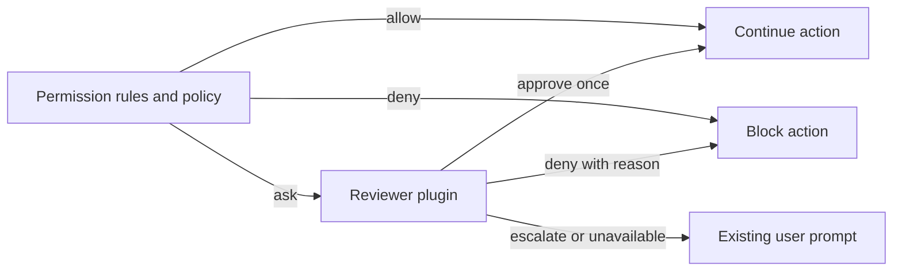

# Automatic permission review

An opt-in, experimental plugin that delegates permission requests to a configured model. It can approve one request, deny it with feedback, or escalate it to OpenCode's existing permission prompt. Both chat models and decision classifiers use the same approval contract.

## Enable locally

Use a server built from the branch containing the `experimental.review` permission hook. Add this plugin to `plugins` in `opencode.jsonc`, selecting a model configured on that server:

```jsonc
{
  "plugins": [
    {
      "package": "./packages/plugins/permission-review",
      "options": {
        "model": { "providerID": "your-provider", "id": "your-model" },
        "mode": "chat",
        "defaultMode": "shadow",
        "actions": ["read", "shell"],
        "policy": "Approve scoped local inspection and tests needed for the user's task. Escalate external writes, publishing, and destructive operations.",
      },
    },
  ],
}
```

The example path is relative to a configuration at the repository root. Use an absolute path when configuring another project. Installing or building the repository alone does not activate the plugin.

Start with `defaultMode: "shadow"`: the reviewer records what it would decide, and every reviewed request still goes to the user. The prompt displays the proposed decision and reason. Use `"manual"` to skip model review or `"auto"` to enforce reviewer decisions. Each session starts with this configured default. For compatibility, when `defaultMode` is omitted, `shadow: true` selects shadow mode and `shadow: false` (or omitted) selects automatic review.

## Session controls

The same package exports both the server plugin and its TUI companion. A connected development TUI discovers the companion from the server's plugin configuration.

- `/permissions` (or **Permissions** in the command palette) opens the session permissions selector. It marks the active preset; **Ctrl+I** shows its details, reviewer model, action filter and inheritance.
- The prompt footer displays the active preset, or the review mode when using configured rules. Selections are stored on the server and survive reconnects. Subagents inherit the nearest selected ancestor's preset, unless explicitly overridden in that child. Unrelated sessions and forks without a parent relationship keep their own selection or the configured default.
- `/permission-review` retains the **Manual**, **Shadow**, and **Approve for me** reviewer-only controls when using configured rules. With a preset selected it opens `/permissions`, so changing the reviewer cannot silently discard the preset's restrictions.
- `/permission-reviews` opens the current session's latest 50 completed assessments. Select a row for the action, resources, model, reason, timing, raw classifier scores, and threshold. Rows distinguish shadow proposals from enforced decisions. Older assessments without classifier diagnostics remain readable.

| Preset           | Permission behavior                                                                              | Reviewer                                 |
| ---------------- | ------------------------------------------------------------------------------------------------ | ---------------------------------------- |
| Read only        | Read and search files; ask before edits, commands, network and other tools                       | Human                                    |
| Ask for approval | Read, search and edit locally; ask for shell, network, outside-directory and other tool requests | Human                                    |
| Approve for me   | Same scope as Ask for approval                                                                   | Model approves once, denies or escalates |
| Shadow           | Same scope as Ask for approval                                                                   | Model suggests; human decides            |
| Full access      | Allow requests except explicit deny rules; requires a second confirmation, defaulting to cancel  | None                                     |
| Configured rules | Restore ordinary configuration and saved grants, with the configured default review mode         | Configured default                       |

Local reads, searches and edits retain existing `ask` requirements, such as protected `.env` reads. All presets preserve explicit configured denials, including agent and session denials. Restrictive presets can require approval even when a saved "Always allow" grant exists; they do not delete those grants. Read only can still perform an edit if the user approves that request. These are tool approval policies, **not an OS sandbox**: an approved shell command runs with your account's filesystem and network access. Requests not covered by the reviewer's `actions` filter still ask the human.

Selections affect subsequent permission evaluations. Reviews already running use the mode selected when they started, and existing prompts still require a reply. The standard unattended policy still applies to headless runs. Keep every connected TUI at **Settings → Session → Permissions → Prompt**, without `--auto`: the separate `autoaccept` setting answers prompts automatically, including reviewer escalations. The selector detects this client's effective mode and refuses prompt-based presets while auto accept is active; its footer identifies the conflict. Other clients can still answer a shared session's prompts.

The controls use the plugin's experimental typed RPC contract, so they require this plugin on the connected server. The selector also requires the fork's small `ui.experimental.permissions.mode()` TUI API to detect auto accept. Older clients receive an update message. No additional HTTP endpoints or generated client changes are needed. The legacy RPC `set` selects configured rules with the requested review mode; the new `select` RPC applies a complete preset.

`actions` matches exact permission action names; omitted means all actions that require approval. Until a preset is selected, the plugin leaves existing rules unchanged: an `allow` bypasses review and a `deny` stays denied. The workspace presets add approval requirements through the existing `permission.evaluate` hook; they do not rewrite configuration or saved grants. Only requests whose final effect is `ask` reach the reviewer.

For a decision model, set `mode` to `decision`. `minConfidence` defaults to `0.98`; lower-confidence responses escalate. This is a routing threshold, not a measured probability of safe execution. Evaluate the selected model and policy on representative actions before relying on it.

## Decision flow



Core calls `ctx.permission.hook("experimental.review", callback)` only from actual `ask` and `assert` requests. Permission probes (`allows`, `assertNotDenied`) and rechecks of pending permissions never invoke it. The hook receives the request with its ID and optional requesting agent, and may set:

```ts
event.result = {
  decision: "approve", // or "deny" or "escalate"
  reason: "The user requested this local inspection.",
}
```

Approval does not save a rule or approve other pending requests. Denial becomes model-facing tool feedback. Escalation shows the reason in the normal permission prompt, where the user can make the decision. Invalid responses, provider failures and the 30-second Core review deadline escalate. Cancelling the caller interrupts review without creating a prompt.

The existing unattended permission policy runs first. Work configured to deny requests that need a human does not gain new authority through this plugin.

## Evidence and trust

The reviewer receives the permission action, resources and metadata, the matching tool input when available, the working directory, and user message text from the active session context. This information goes to the selected model provider using OpenCode's existing credentials. The plugin does not send attachments, reasoning, or unrelated tool outputs. It also excludes the request's `save` patterns: those describe future rules for the human's "Always allow" option, while the reviewer can approve only the current request. The human's options remain unchanged.

The review uses a separate, stateless model call with no tools. Request contents and assistant claims are evidence, not authority to change review policy. Compaction can remove earlier user instructions; the reviewer is told that missing context means uncertainty. Evidence above 48,000 characters escalates without truncation. This initial evidence path does not retrieve older instructions or a parent session's authorization for subagents.

The model and policy are trusted to make the review decision. This adds no operating-system sandbox, and prompt instructions alone do not guarantee resistance to prompt injection. Ordinary plugins already run trusted code in the harness. Configure one approval reviewer; this plugin leaves an earlier review hook's result unchanged.

Completed plugin assessments are logged and stored in plugin storage under `review/<requestID>` with session ID, action, resources, selected model, time, duration, shadow mode, decision and reason. Decision-model assessments also store `classifier.choice`, `confidence`, `probabilities`, and `threshold` when a choice is returned. The reason shows the raw choice and confidence even when the threshold routes it to the user. In shadow mode, `decision` is the proposal after applying the threshold; the user still decides. This is a record of the assessment, not proof the tool executed or how the user replied. Core-level timeouts and hook defects produce the fallback prompt without a completed plugin assessment.

## Validation and next steps

Core tests cover rule precedence, probes, one-request scope, denial feedback, human escalation, invalid output, defects, timeout and cancellation. Plugin tests cover both adapters, session mode isolation and persistence, legacy history, and the real TUI selector and details. Server tests ensure the direct permission API waits for plugin activation before evaluating configured rules and hooks. Deterministic tests do not measure a real model's judgment quality.

For real model trials, see [the evaluation guide](evaluation/README.md). It includes Maple System One configuration, a runner that executes no proposed actions, and the first recorded classifier results.

Before enabling broader automation, collect representative shadow decisions with the chosen model, including prompt injection attempts and compacted or delegated sessions. This version uses a stateless reviewer; it does not retrieve older authorization or investigate unknown scripts. A reviewer with restricted inspection tools remains a possible follow-up if those evidence gaps cause excessive escalation.
