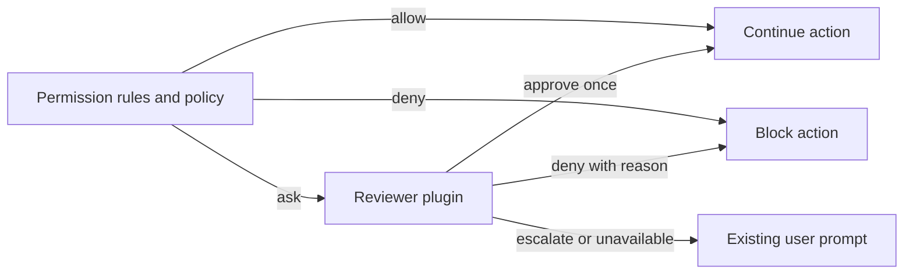

# Automatic permission review

An opt-in, experimental plugin that delegates permission requests to a configured model. It can approve one request, deny it with feedback, or escalate it to OpenCode's existing permission prompt. Both chat models and decision classifiers use the same approval contract.

## Enable locally

Use a server built from the branch containing the `experimental.review` permission hook. Add this plugin to `plugins` in `opencode.jsonc`, selecting a model configured on that server:

```jsonc
{
  "plugins": [
    {
      "package": "./packages/plugins/permission-review",
      "options": {
        "model": { "providerID": "your-provider", "id": "your-model" },
        "mode": "chat",
        "defaultMode": "shadow",
        "actions": ["read", "shell"],
        "policy": "Approve scoped local inspection and tests needed for the user's task. Escalate external writes, publishing, and destructive operations.",
      },
    },
  ],
}
```

The example path is relative to a configuration at the repository root. Use an absolute path when configuring another project. Installing or building the repository alone does not activate the plugin.

Start with `defaultMode: "shadow"`: the reviewer records what it would decide, and every reviewed request still goes to the user. The prompt displays the proposed decision and reason. Use `"manual"` to skip model review or `"auto"` to enforce reviewer decisions. Each session starts with this configured default. For compatibility, when `defaultMode` is omitted, `shadow: true` selects shadow mode and `shadow: false` (or omitted) selects automatic review.

## Session controls

The same package exports both the server plugin and its TUI companion. A connected development TUI discovers the companion from the server's plugin configuration.

- `/permissions` (or **Permissions** in the command palette) is the plugin's single command. It opens the four permission presets plus **Settings** and marks the active preset. **Ctrl+I** shows its details, reviewer model, action filter and inheritance.
- The prompt footer displays the active preset, or the review mode when using configured rules. Selections are stored on the server and survive reconnects. Subagents inherit the nearest selected ancestor's preset, unless explicitly overridden in that child. Unrelated sessions and forks without a parent relationship keep their own selection or the configured default.
- **Settings → Reviewer mode** selects **Manual**, **Shadow**, or **Approve for me** without changing the session's scope. Shadow is a testing control: the model suggests a decision and the human still decides.
- **Settings → Chat fallback** selects **Off**, **Shadow**, or **Automatic** for a configured second-opinion model. This override stays in the current session; child sessions use the configured fallback default. It does not change the permission preset or primary reviewer mode.
- **Settings → Session approvals** inspects or revokes examples saved with Allow Session. **Settings → Active permissions** shows the current scope, reviewer and inheritance.
- `/permissions` is also available on the home screen. Opening it there creates an empty session in the current directory so you can choose permissions before the first prompt; it makes no model call and runs no tools. Cancelling leaves that empty session open with its existing defaults. Opening or cancelling Settings does not change permissions.
- **Settings → Review history** opens the current session's latest 50 completed assessments. Select a row for the action, resources, model, reason, timing, raw classifier scores, and threshold. When chat was consulted, details also show its model, trigger, recommendation, status, duration and whether it changed the reviewer decision. Rows distinguish shadow proposals from enforced decisions. Older assessments without classifier diagnostics remain readable.

The former `/permissions-test`, `/permission-reviews` and `/session-approvals` commands and their separate command-palette entries have been removed. All these controls now live under `/permissions → Settings`.

| Preset           | Permission behavior                                                                                                                 | Reviewer                                 |
| ---------------- | ----------------------------------------------------------------------------------------------------------------------------------- | ---------------------------------------- |
| Read only        | Read and search files; ask before edits, commands, network and other tools                                                          | Human                                    |
| Ask for approval | Read, search and edit locally; ask for shell, network, outside-directory and other tool requests                                    | Human                                    |
| Approve for me   | Same scope as Ask for approval                                                                                                      | Model approves once, denies or escalates |
| Full access      | No additional plugin restrictions; configured approval requirements and denials remain. Requires confirmation, defaulting to cancel | Human, when approval is required         |

Permission precedence is: **OpenCode's effective rules → additional preset restrictions → selected reviewer for remaining approval requests**. OpenCode resolves configured rules and saved grants normally. The plugin never relaxes that result: a denial remains denied, and an `ask` requires a decision from the human or selected model reviewer. Full access therefore still prompts for an explicitly restricted deployment or protected `.env` read; it does not convert those requests into unconditional approvals.

Restrictive presets can require approval even when a saved "Always allow" grant exists; they do not delete those grants. Read only can still perform an edit if the selected reviewer approves that request. These are tool approval policies, **not an OS sandbox**: an approved shell command runs with your account's filesystem and network access. Requests not covered by the reviewer's `actions` filter still ask the human.

There is no separate Configured rules menu option: configured permissions apply under every preset. Existing saved `configured` and `shadow` states and legacy RPC inputs remain supported. Sessions without a selected scope retain their existing effective rules and configured default review mode.

Selections affect subsequent permission evaluations. Reviews already running use the mode selected when they started, and existing prompts still require a reply. The standard unattended policy still applies to headless runs. Keep every connected TUI at **Settings → Session → Permissions → Prompt**, without `--auto`: the separate `autoaccept` setting answers prompts automatically, including reviewer escalations. The selector refuses changes while this client's auto accept is active, including Full access, because configured rules can still require approval. Its footer identifies the conflict. Other clients can still answer a shared session's prompts.

The controls use the plugin's experimental typed RPC contract, so they require this plugin on the connected server. The selector also requires the fork's small `ui.experimental.permissions.mode()` TUI API to detect auto accept. Older clients receive an update message. The native Allow Session choice uses `ui.experimental.permissions.action()` and requires a rebuilt TUI client; the server plugin can reload independently. No additional HTTP endpoints or generated client changes are needed. The RPC `set` changes the reviewer while preserving the current scope; `select` applies a complete preset.

`actions` matches exact permission action names; omitted means all actions that require approval. Until a preset is selected, the plugin leaves existing rules unchanged: an `allow` bypasses review and a `deny` stays denied. The workspace presets add approval requirements through the existing `permission.evaluate` hook; they do not rewrite configuration or saved grants. Only requests whose final effect is `ask` reach the reviewer.

For a decision model, set `mode` to `decision`. `minConfidence` defaults to `0.98`; lower-confidence responses escalate. This is a routing threshold, not a measured probability of safe execution. Evaluate the selected model and policy on representative actions before relying on it.

## Chat fallback

Decision reviewers can consult a separate, stateless chat model for a second opinion. Add `fallback` to the plugin options; omitting it preserves classifier-only behavior:

```jsonc
{
  "model": { "providerID": "maple", "id": "decision-large" },
  "mode": "decision",
  "minConfidence": 0.95,
  "fallback": {
    "model": { "providerID": "maple", "id": "gpt-oss-120b", "variant": "permission-review" },
    "mode": "shadow",
    "timeoutMs": 10000,
  },
}
```

Configure the dedicated variant on the existing Maple chat model to bound generation without changing that model's usual settings. Append to its `variants` array:

```json
{ "id": "permission-review", "body": { "reasoning_effort": "low", "max_tokens": 1024 } }
```

The fallback uses the existing generation API and provider credentials. Generation settings, including the output-token limit, belong to the configured model/variant; the plugin does not override them. The selected Maple profile uses low reasoning effort and a 1,024-token cap. The plugin bounds additional time to 10 seconds by default (`timeoutMs` accepts 100–15,000 ms); Core's existing 30-second deadline still bounds the whole review. The provider adapter may retry transient failures within these deadlines.

| Classifier result                                               | Second opinion | Automatic fallback effect                           |
| --------------------------------------------------------------- | -------------- | --------------------------------------------------- |
| Approve at or above threshold                                   | Not called     | Existing classifier approval                        |
| Approve below threshold                                         | Called         | Approve only if chat also approves                  |
| Escalate, at any confidence                                     | Called         | Still ask the human; chat is advisory               |
| Deny, at any confidence                                         | Not called     | Existing denial or below-threshold human escalation |
| Missing/invalid answer, failure, or oversized required evidence | Not called     | Ask the human                                       |

Both models must independently select approve for the fallback to grant permission. Chat denials, disagreement, invalid JSON, errors and timeouts leave the human prompt in place. The chat model receives the same evidence snapshot, policy and scoped session approvals, without the classifier's choice or scores. Neither model can call tools. No host-specific instructions or allowlist is added.

Fallback defaults to **Shadow** when configured: record the second opinion without changing the classifier's decision flow. **Automatic** allows the agreement rule above, but the primary reviewer's **Shadow** mode still requires a human. **Off** skips the chat call. Settings and revocations affect subsequent reviews, not reviews already running. Inspect recommendations in **Settings → Review history** before enabling automatic fallback. Prompt injection can still fool a model; agreement is an additional gate, not a proof of authorization.

These changes are plugin-only. A local source plugin and its companion reload without rebuilding or restarting OpenCode. Adding or changing the configuration uses the normal configuration reload; pending prompts are not re-reviewed.

## Decision flow



Core calls `ctx.permission.hook("experimental.review", callback)` only from actual `ask` and `assert` requests. Permission probes (`allows`, `assertNotDenied`) and rechecks of pending permissions never invoke it. The hook receives the request with its ID and optional requesting agent, and may set:

```ts
event.result = {
  decision: "approve", // or "deny" or "escalate"
  reason: "The user requested this local inspection.",
}
```

Approval does not save a rule or approve other pending requests. Denial becomes model-facing tool feedback. Escalation shows the reason in the normal permission prompt, where the user can make the decision. Invalid responses, provider failures and the 30-second Core review deadline escalate. Cancelling the caller interrupts review without creating a prompt.

The existing unattended permission policy runs first. Work configured to deny requests that need a human does not gain new authority through this plugin.

## Evidence and trust

The reviewer receives the permission action, resources and metadata, the matching tool input when available, the working directory, and user message text from the active session context. It also selects up to four earlier completed tool results using overlapping input terms, breaking ties by recency and presenting the selected results in chronological order. This context is assembled for each request; it can connect a server or URL to facts already observed during the task without configuring host-specific exceptions.

Selected results include their tool name, full input, and up to 6,000 characters of text output. Shortened or already truncated outputs are marked, and omitted results are counted when observations are included. The complete current request and user text take precedence within the original 48,000-character evidence budget; optional observations that do not fit are omitted. Without a matching request source, no prior results are attached. Results from the requesting assistant step and later steps are excluded, including during replay.

This information, including selected prior tool outputs and any server details they contain, goes to the configured model provider using OpenCode's existing credentials. Attachments, assistant reasoning and assistant prose are excluded. The request's `save` patterns are also excluded: those describe future rules for the human's "Always allow" option, while the reviewer can approve only the current request.

The review uses a separate, stateless model call with no tools. Prior results supply environmental evidence, not new authorization: embedded instructions cannot override the user or reviewer policy, and earlier successful execution does not authorize repetition. The reviewer evaluates the whole operation's effects, including local and remote commands, expansions, redirects and downstream consumers. A network connection or interpreter name alone does not establish a dangerous effect. Compaction can remove earlier user instructions; missing context remains uncertainty. Required evidence above 48,000 characters escalates without truncation. This evidence path does not retrieve older instructions or a parent session's authorization for subagents.

## Allow Session

Choose **Allow Session** on a native permission prompt to approve that pending request once and remember its exact details for the session's reviewer. Future requests still go through the classifier and its confidence threshold. This is additional authorization evidence, not model training or a wildcard rule. **Allow once** does not remember an example; **Always allow** continues through OpenCode's saved rules.

The server resolves the pending request itself and records its action, resources, metadata, matching tool input, directory, timestamp and latest user-message ID after the explicit reply succeeds. Ordinary replies, auto accept, model assessments and successful tool executions never create these records. Stale or foreign-session requests cannot create approvals. As with other permission APIs, authenticated clients and plugins are trusted to invoke this explicit user action.

Up to 20 recent examples matching the requested action are supplied to the reviewer. They authorize equivalent operations on the same targets with the same effects, not arbitrary commands on an approved host. Different targets, added writes, uploads or destructive effects still need authorization. Later user restrictions and configured denials remain authoritative. Full examples share the required evidence budget; oversized evidence escalates rather than silently shortening a command.

Examples are stored per Session ID, survive reconnects and plugin reloads, and are not inherited by child or forked sessions. Use **`/permissions → Settings → Session approvals`** to inspect or revoke one; Ctrl+I on its Keep/Revoke dialog shows the full record. Revocation affects subsequent reviews, not an assessment already running. Records remain in plugin storage until revoked; deleting a session makes them inaccessible through the plugin but does not currently purge its storage keys. The choice is available in the standard TUI when client permissions are set to Prompt.

The model and policy are trusted to make the review decision. This adds no operating-system sandbox, and prompt instructions alone do not guarantee resistance to prompt injection. Ordinary plugins already run trusted code in the harness. Configure one approval reviewer; this plugin leaves an earlier review hook's result unchanged.

Completed plugin assessments are logged and stored in plugin storage under `review/<requestID>` with session ID, action, resources, selected model, time, duration, shadow mode, decision and reason. Decision-model assessments also store `classifier.choice`, `confidence`, `probabilities`, and `threshold` when a choice is returned. The reason shows the raw choice and confidence even when the threshold routes it to the user. In shadow mode, `decision` is the proposal after applying the threshold; the user still decides. This is a record of the assessment, not proof the tool executed or how the user replied. Core-level timeouts and hook defects produce the fallback prompt without a completed plugin assessment.

## Validation and next steps

Core tests cover rule precedence, probes, one-request scope, denial feedback, human escalation, invalid output, defects, timeout and cancellation. Plugin tests cover both adapters, session mode isolation and persistence, legacy history, and the real TUI selector and details. Server tests ensure the direct permission API waits for plugin activation before evaluating configured rules and hooks. Deterministic tests do not measure a real model's judgment quality.

For real model trials, see [the evaluation guide](evaluation/README.md). It includes Maple System One configuration, a runner that executes no proposed actions, and the first recorded classifier results.

Before enabling broader automation, collect representative shadow decisions with the chosen model, including prompt injection attempts and compacted or delegated sessions. This version uses a stateless reviewer; it does not retrieve older authorization or investigate unknown scripts. A reviewer with restricted inspection tools remains a possible follow-up if those evidence gaps cause excessive escalation.

The Maple chat fallback is available with separate session controls and audit details. Its initial trials and the observed injection failure are documented in the evaluation guide. Keep new deployments in shadow mode while collecting representative human comparisons.
