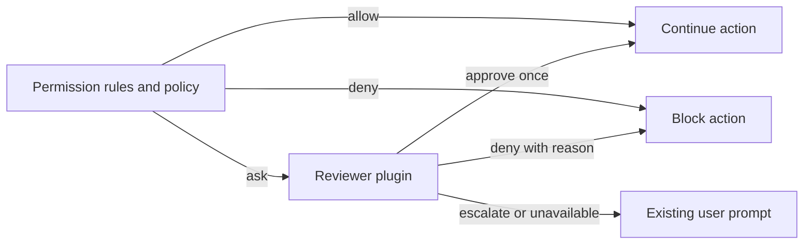

# Automatic permission review

An opt-in, experimental plugin that delegates permission requests to a configured model. It can approve one request, deny it with feedback, or escalate it to OpenCode's existing permission prompt. Both chat models and decision classifiers use the same approval contract.

## Enable locally

Use a server built from the branch containing the `experimental.review` permission hook. Add this plugin to `plugins` in `opencode.jsonc`, selecting a model configured on that server:

```jsonc
{
  "plugins": [
    {
      "package": "./packages/plugins/permission-review",
      "options": {
        "model": { "providerID": "your-provider", "id": "your-model" },
        "mode": "chat",
        "defaultMode": "shadow",
        "actions": ["read", "shell"],
        "policy": "Approve scoped local inspection and tests needed for the user's task. Escalate external writes, publishing, and destructive operations.",
      },
    },
  ],
}
```

The example path is relative to a configuration at the repository root. Use an absolute path when configuring another project. Installing or building the repository alone does not activate the plugin.

Start with `defaultMode: "shadow"`: the reviewer records what it would decide, and every reviewed request still goes to the user. The prompt displays the proposed decision and reason. Use `"manual"` to skip model review or `"auto"` to enforce reviewer decisions. Each session starts with this configured default. For compatibility, when `defaultMode` is omitted, `shadow: true` selects shadow mode and `shadow: false` (or omitted) selects automatic review.

## Session controls

The same package exports both the server plugin and its TUI companion. A connected development TUI discovers the companion from the server's plugin configuration.

- `/permission-review` (or **Permission review mode** in the command palette) selects **Manual**, **Shadow**, or **Approve for me** for the current session.
- The prompt footer displays the current review mode. The selection is stored on the server and survives reconnects; other sessions, children, and forks use their own selection or the configured default.
- `/permission-reviews` opens the current session's latest 50 completed assessments. Select a row for the action, resources, model, reason, timing, raw classifier scores, and threshold. Rows distinguish shadow proposals from enforced decisions. Older assessments without classifier diagnostics remain readable.

Mode changes apply to subsequent requests. Reviews already running use the mode selected when they started, and existing prompts still require a reply. Manual mode skips the reviewer; existing permission rules still apply. Keep the TUI's own permission setting at `prompt`: its separate `autoaccept` setting answers permission prompts automatically, including reviewer escalations.

The controls use the plugin's experimental typed RPC contract, so they require this plugin on the connected server. No additional HTTP API or generated client changes are needed.

`actions` matches exact permission action names; omitted means all actions that require approval. The plugin does not change permission rules. An existing `allow` bypasses review and an existing `deny` stays denied. To have an action reviewed, its effective rule must be `ask`.

For a decision model, set `mode` to `decision`. `minConfidence` defaults to `0.98`; lower-confidence responses escalate. This is a routing threshold, not a measured probability of safe execution. Evaluate the selected model and policy on representative actions before relying on it.

## Decision flow



Core calls `ctx.permission.hook("experimental.review", callback)` only from actual `ask` and `assert` requests. Permission probes (`allows`, `assertNotDenied`) and rechecks of pending permissions never invoke it. The hook receives the request with its ID and optional requesting agent, and may set:

```ts
event.result = {
  decision: "approve", // or "deny" or "escalate"
  reason: "The user requested this local inspection.",
}
```

Approval does not save a rule or approve other pending requests. Denial becomes model-facing tool feedback. Escalation shows the reason in the normal permission prompt, where the user can make the decision. Invalid responses, provider failures and the 30-second Core review deadline escalate. Cancelling the caller interrupts review without creating a prompt.

The existing unattended permission policy runs first. Work configured to deny requests that need a human does not gain new authority through this plugin.

## Evidence and trust

The reviewer receives the permission action, resources and metadata, the matching tool input when available, the working directory, and user message text from the active session context. This information goes to the selected model provider using OpenCode's existing credentials. The plugin does not send attachments, reasoning, or unrelated tool outputs. It also excludes the request's `save` patterns: those describe future rules for the human's "Always allow" option, while the reviewer can approve only the current request. The human's options remain unchanged.

The review uses a separate, stateless model call with no tools. Request contents and assistant claims are evidence, not authority to change review policy. Compaction can remove earlier user instructions; the reviewer is told that missing context means uncertainty. Evidence above 48,000 characters escalates without truncation. This initial evidence path does not retrieve older instructions or a parent session's authorization for subagents.

The model and policy are trusted to make the review decision. This adds no operating-system sandbox, and prompt instructions alone do not guarantee resistance to prompt injection. Ordinary plugins already run trusted code in the harness. Configure one approval reviewer; this plugin leaves an earlier review hook's result unchanged.

Completed plugin assessments are logged and stored in plugin storage under `review/<requestID>` with session ID, action, resources, selected model, time, duration, shadow mode, decision and reason. Decision-model assessments also store `classifier.choice`, `confidence`, `probabilities`, and `threshold` when a choice is returned. The reason shows the raw choice and confidence even when the threshold routes it to the user. In shadow mode, `decision` is the proposal after applying the threshold; the user still decides. This is a record of the assessment, not proof the tool executed or how the user replied. Core-level timeouts and hook defects produce the fallback prompt without a completed plugin assessment.

## Validation and next steps

Core tests cover rule precedence, probes, one-request scope, denial feedback, human escalation, invalid output, defects, timeout and cancellation. Plugin tests cover both adapters, session mode isolation and persistence, legacy history, and the real TUI selector and details. Server tests ensure the direct permission API waits for plugin activation before evaluating configured rules and hooks. Deterministic tests do not measure a real model's judgment quality.

For real model trials, see [the evaluation guide](evaluation/README.md). It includes Maple System One configuration, a runner that executes no proposed actions, and the first recorded classifier results.

Before enabling broader automation, collect representative shadow decisions with the chosen model, including prompt injection attempts and compacted or delegated sessions. This version uses a stateless reviewer; it does not retrieve older authorization or investigate unknown scripts. A reviewer with restricted inspection tools remains a possible follow-up if those evidence gaps cause excessive escalation.
